# ShopSphere – E-Commerce Analytics Pipeline: Workflow & Diagrams

> Open this file in VS Code and press `Ctrl+Shift+V` (Mac: `Cmd+Shift+V`) to preview.
> Install the extension **"Markdown Preview Mermaid Support"** so the diagrams render.

---

## 1. End-to-End Workflow (Big Picture)

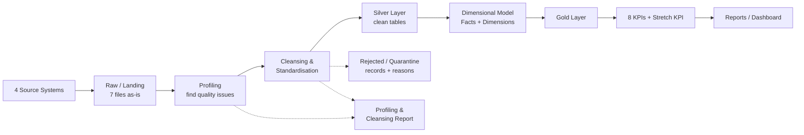

---

## 2. Source Systems → Raw Files

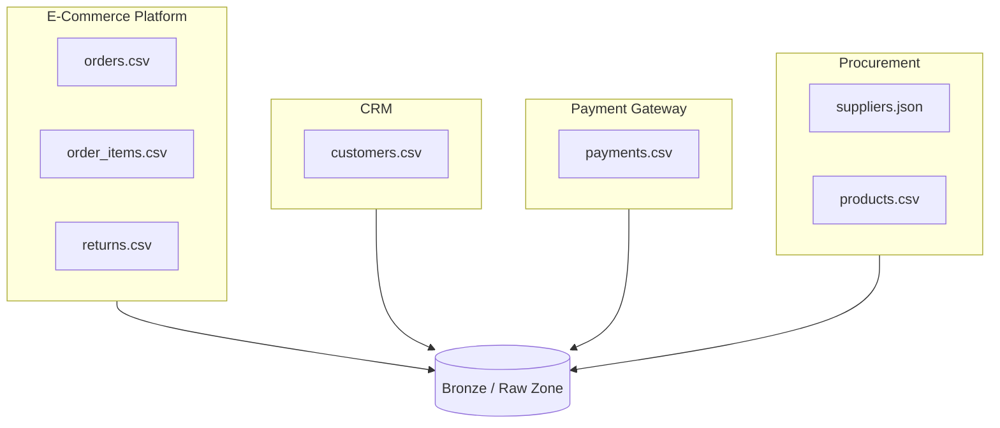

---

## 3. Medallion Architecture (Bronze → Silver → Gold)

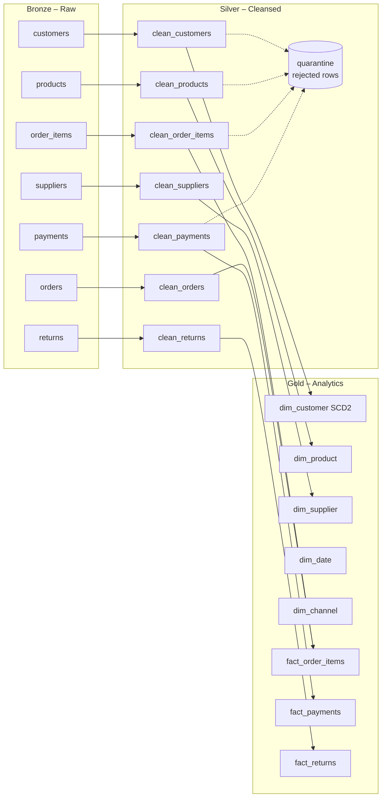

---

## 4. Cleansing Workflow (applied to every table)

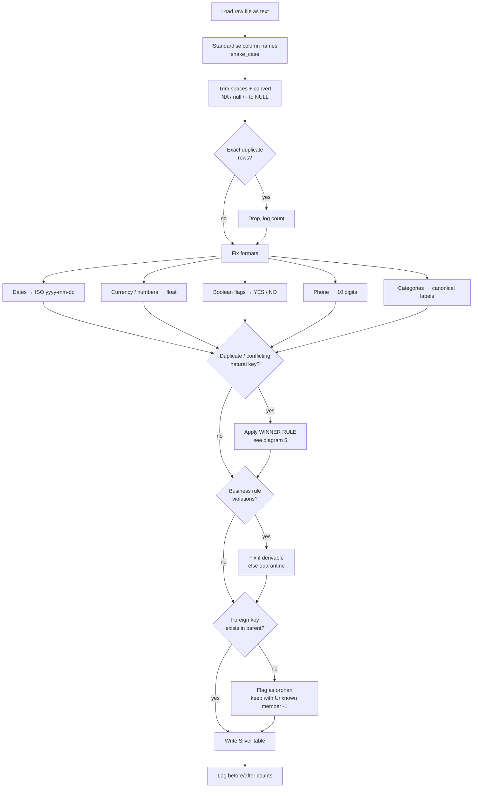

---

## 5. "Which Record Wins" Rule for Duplicates / Conflicts

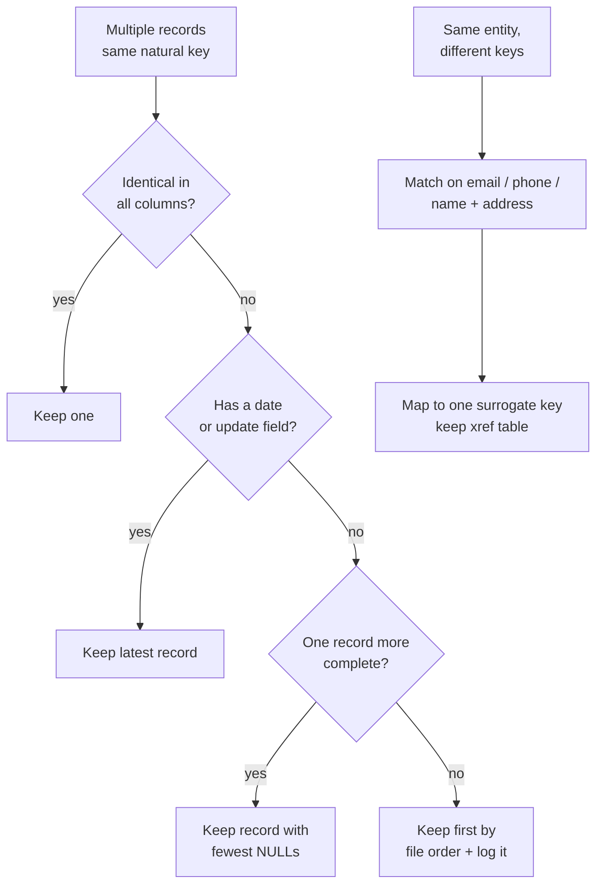

---

## 6. Data-Quality Issues → Fix Map

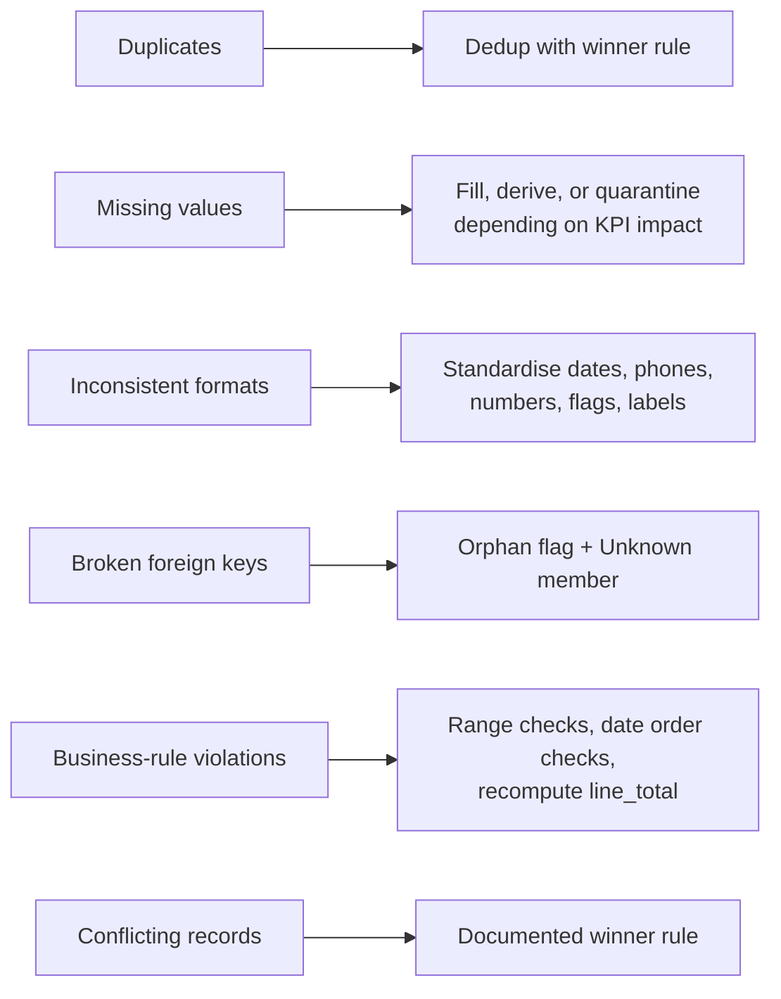

---

## 7. Star Schema (Gold Layer)

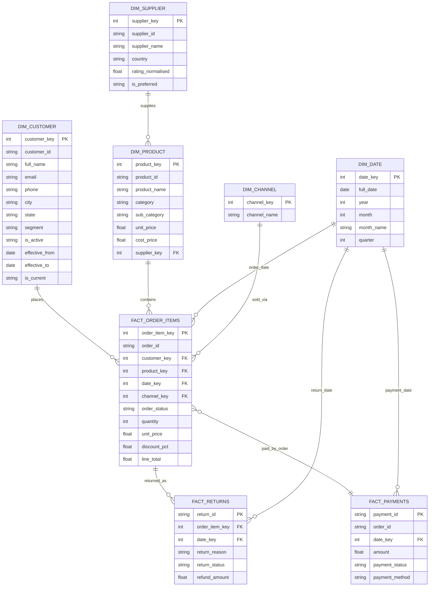

---

## 8. Slowly Changing Dimension – Customer (SCD Type 2)

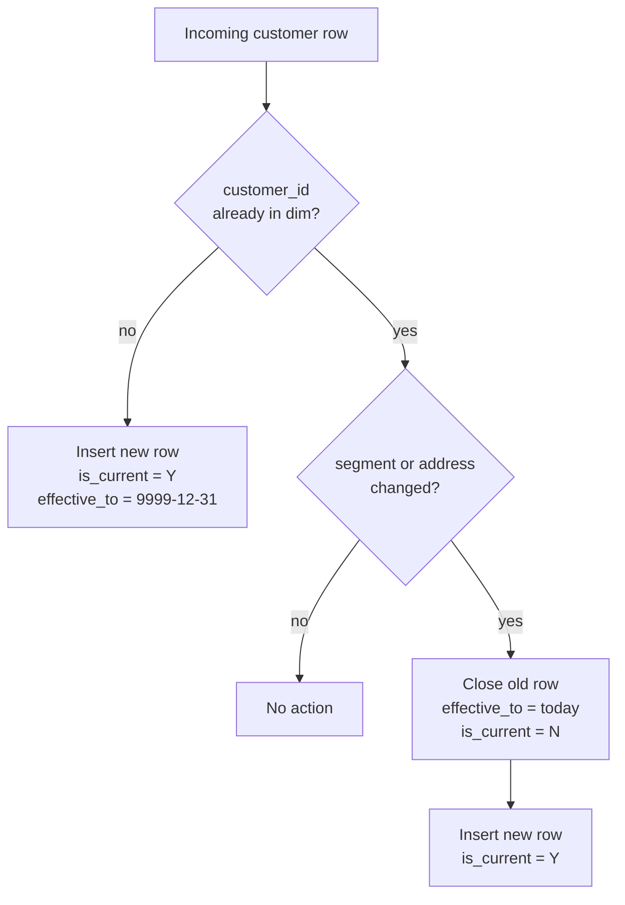

Example:

| customer_key | customer_id | segment | effective_from | effective_to | is_current |
|---|---|---|---|---|---|
| 1 | C001 | Silver | 2024-01-10 | 2025-03-31 | N |
| 2 | C001 | Gold | 2025-04-01 | 9999-12-31 | Y |

Facts join to the customer row that was valid on the **order date**.

---

## 9. KPI Dependency Map (Which Tables Feed Which KPI)

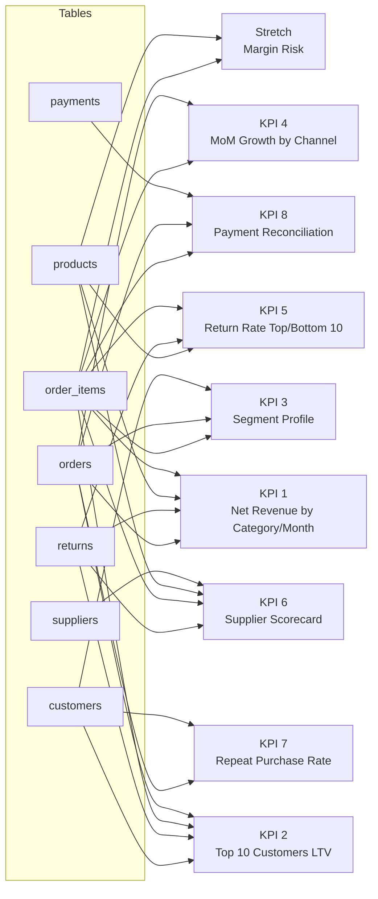

---

## 10. Core KPI Formulas

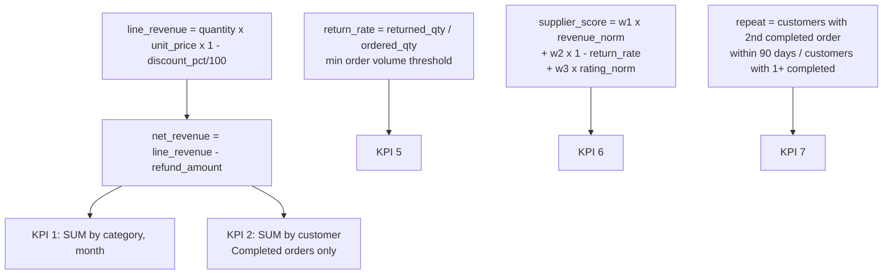

---

## 11. Payment Reconciliation Logic (KPI 8)

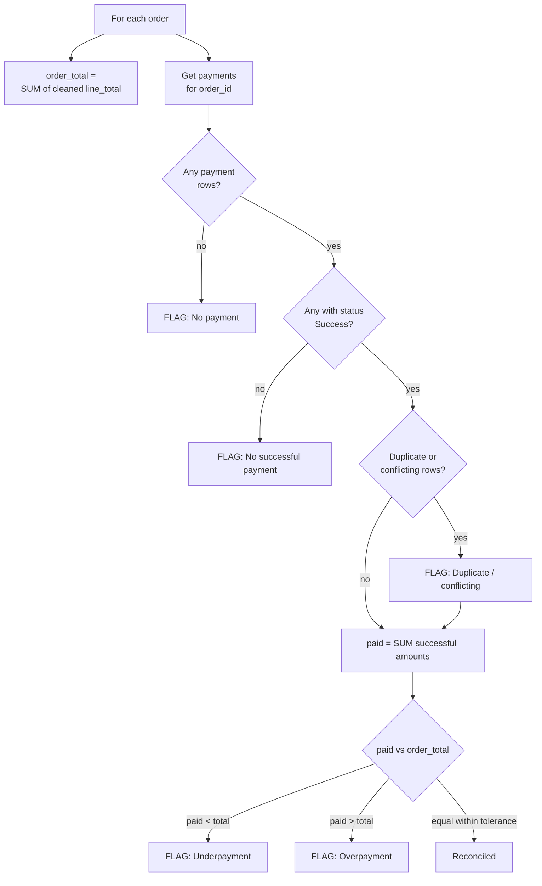

---

## 12. Customer Repeat-Purchase Logic (KPI 7)

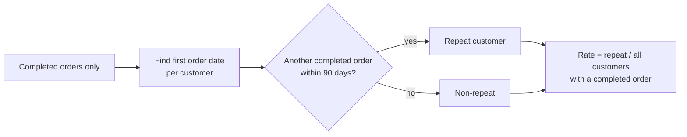

---

## 13. Orphan Handling Decision (Referential Integrity)

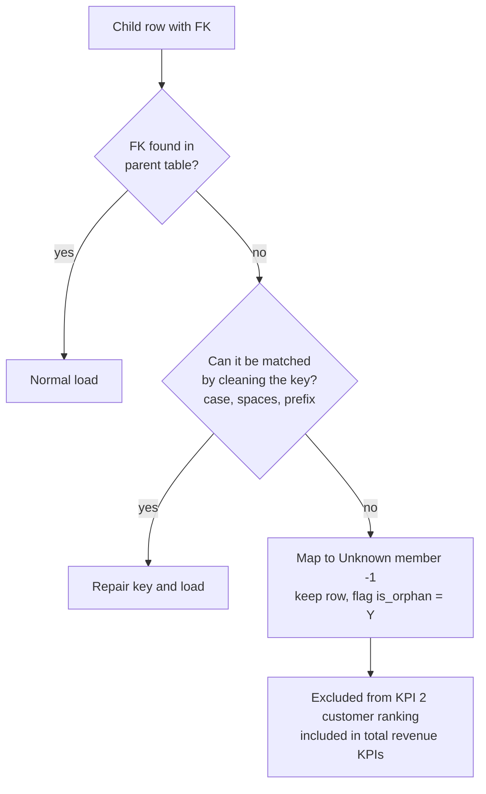

---

## 14. Project Folder Structure

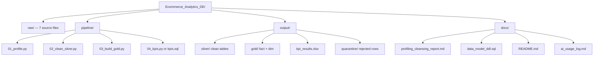

---

## 15. Execution Order (Pipeline Run)

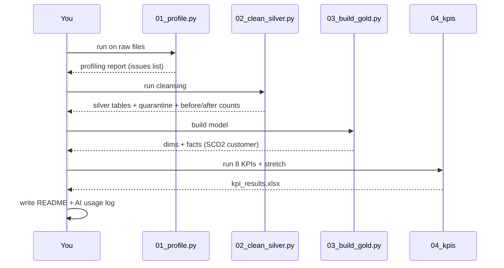

---

## 16. AI Usage & Validation Loop (for the AI log deliverable)

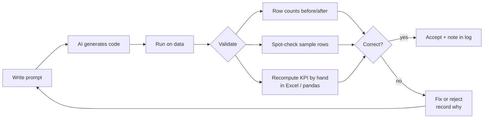

---

## 17. Suggested Time Plan (4–6 hours)

```mermaid
gantt
    title Assessment Time Plan
    dateFormat HH:mm
    axisFormat %H:%M
    section Foundation
    Profiling           :a1, 00:00, 40m
    Cleansing rules     :a2, after a1, 80m
    section Modelling
    Dimensional design  :a3, after a2, 40m
    Pipeline build      :a4, after a3, 55m
    section Output
    KPIs                :a5, after a4, 105m
    Docs + AI log       :a6, after a5, 20m
```
